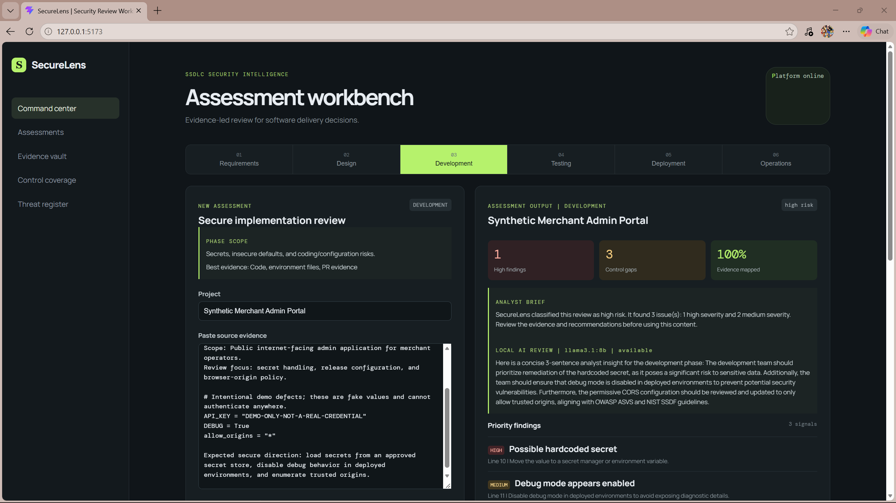
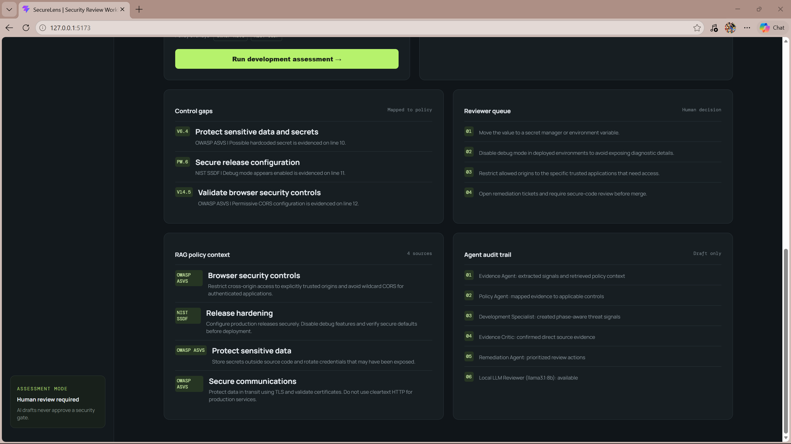
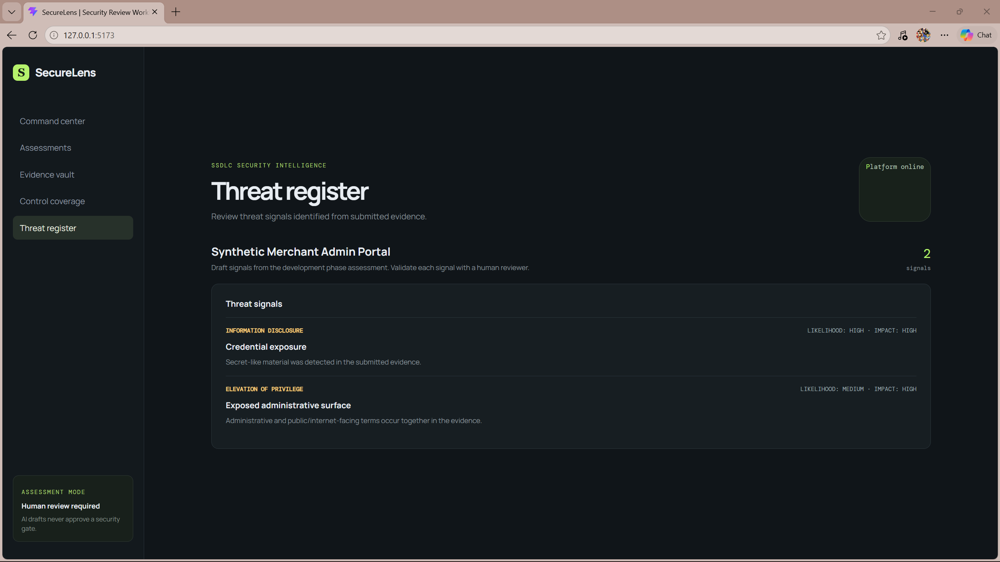
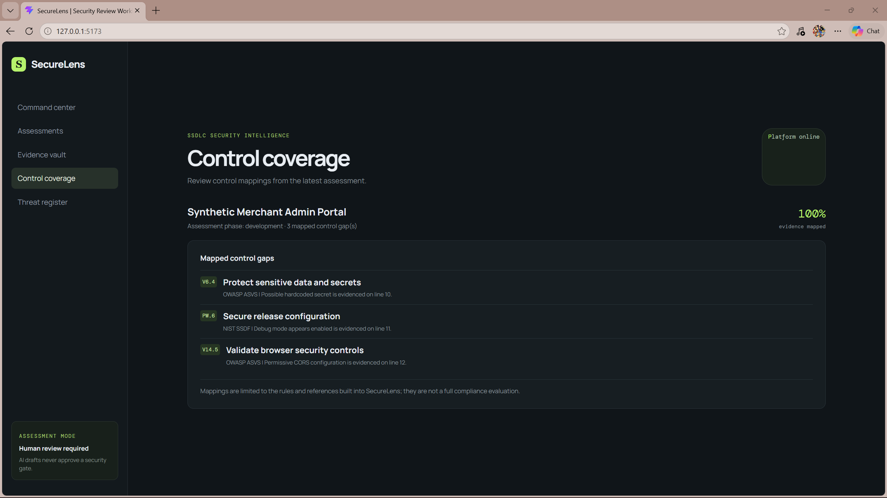

# SecureLens

SecureLens is a local-first security review workbench for configuration text and software delivery evidence. It combines deterministic checks with a phase-aware assessment draft so a human reviewer can investigate findings and decide what to do next.

> SecureLens is a first-pass review aid. Findings, control mappings, threat signals, and suggested actions require human validation. A clean result does not prove that a system is secure.

## What it does

- Scans text for hardcoded secret-like values, private keys, insecure HTTP URLs, disabled TLS verification, enabled debug mode, and permissive CORS.
- Runs a LangGraph assessment workflow for the requirements, design, development, testing, deployment, and operations phases.
- Produces a risk label, evidence-linked findings, draft threat signals, selected control mappings, retrieved policy context, and suggested review actions.
- Accepts pasted evidence or `.txt`, `.md`, `.csv`, `.json`, `.pdf`, `.docx`, and `.xlsx` files in the assessment workflow. Uploads are limited to 10 MB.
- Uses a React and TypeScript interface with a FastAPI backend.
- Can use a local Ollama model for an advisory narrative and local embeddings. The model does not set deterministic findings or approve a security gate. Without Ollama, the assessment continues with its deterministic pipeline and lexical retrieval.
- Saves assessment history, review decisions, remediation actions, and uploaded knowledge documents to a local SQLite database by default.

The built-in knowledge base includes a curated, paraphrased subset of OWASP ASVS 5.0.0 and NIST SSDF 1.1 practices. Each standards excerpt carries its framework version, requirement/practice ID, and official source link in the assessment's policy context. These excerpts are reference material for retrieval, not a complete implementation or certification of either framework. OWASP ASVS is available under CC BY-SA 4.0; NIST SP 800-218 is a U.S. government publication.

| Source | Included topics |
| --- | --- |
| [OWASP ASVS 5.0.0](https://github.com/OWASP/ASVS/tree/v5.0.0_release) | V13.3.1 secrets management; V13.4.2 production debug settings; V3.4.2 CORS origin validation; V12.2.1 TLS to external services; V12.3.2 TLS certificate validation |
| [NIST SP 800-218 SSDF 1.1](https://csrc.nist.gov/pubs/sp/800/218/final) | PW.1.1 risk modeling; PW.1.2 security requirements and design decisions; PW.7.2 code review; PW.8.2 security testing; PW.9.1 secure baseline configurations |

For synthetic, copy-pasteable evidence packs and expected demo outputs for every SSDLC phase and sidebar view, see the [demo check and screenshot guide](samples/securelens-demo-guide.md).

## Requirements

- Python 3.10 or newer
- Node.js and npm
- Ollama is optional. To enable local model drafting and embeddings, install Ollama and pull the models configured in `.env.example`.

## Run locally

From the repository root, create and activate a virtual environment, then install the backend dependencies:

```powershell
py -m venv .venv
.\.venv\Scripts\Activate.ps1
pip install -r requirements.txt
```

Start the API in the first terminal:

```powershell
fastapi dev app/main.py --port 8010
```

In a second terminal, install and start the frontend:

```powershell
cd frontend
npm install
npm run dev
```

Open the Vite URL shown in the terminal (normally `http://localhost:5173`). The frontend uses `http://127.0.0.1:8010/api` by default.

To use a different API base URL, set `VITE_API_BASE_URL` before starting Vite. It should point to the API prefix, such as `https://your-api.example.com/api`:

```powershell
$env:VITE_API_BASE_URL = "https://your-api.example.com/api"
npm run dev
```

The API's CORS configuration currently allows the default local Vite origins. Update it before hosting the frontend at another origin.

## Run with Docker Compose

With Docker Desktop (or Docker Engine and the Compose plugin) running, build and start both services from the repository root:

```sh
docker compose up --build
```

Open the frontend at `http://localhost:5173` and the API docs at `http://localhost:8010/docs`. Assessment history and uploaded knowledge documents persist in the named `securelens-data` volume. Stop the services with `docker compose down`; the data volume remains. Remove it only when you intend to discard the local database with `docker compose down --volumes`.

The compose setup runs the deterministic review path. The API container does not connect to an Ollama process running on the host by default; use the local development setup above for the simplest Ollama integration.

## Optional local Ollama setup

Ollama must be running at `http://127.0.0.1:11434`, and the configured model names must match models shown by `ollama list`. The defaults in `.env.example` are `llama3.2` for advisory review and `nomic-embed-text` for embeddings. For example, if your installed chat model is `llama3.1:8b`, set it in the same PowerShell terminal before starting the API:

```powershell
$env:OLLAMA_MODEL = "llama3.1:8b"
fastapi dev app/main.py --port 8010
```

The Ollama request timeout defaults to 30 seconds and can be changed with `OLLAMA_TIMEOUT_SECONDS`. If Ollama is unavailable, the app reports that status and continues without model-generated text or embeddings.

## Data handling

In the default local setup, the browser sends assessment text or an uploaded file to the local FastAPI API. Assessment results and uploaded knowledge documents are stored in the SQLite database at `data/securelens.db` by default. The optional Ollama calls also target a local service by default. If you point the frontend or Ollama configuration at another machine, submitted content may be sent to that machine. Do not use real credentials or sensitive production evidence in a public demo.

## API overview

- `GET /api/health` — service health
- `POST /api/scan` — deterministic scan
- `POST /api/review` — risk label and analyst brief
- `POST /api/assessments` — assessment from text
- `POST /api/assessments/upload` — assessment from an uploaded document
- `POST /api/knowledge/documents` — add a local policy document to the knowledge base
- `GET /api/assessments/{assessment_id}` — retrieve an assessment and its review state
- `POST /api/assessments/{assessment_id}/review` — record a human review decision
- `PATCH /api/remediations/{action_id}` — update a remediation action

Interactive API documentation is available at `http://127.0.0.1:8010/docs` while the local API is running.

## Verify

Run the backend tests and build the frontend:

```powershell
py -m pytest -q
cd frontend
npm run build
```

GitHub Actions runs the same backend test command and frontend production build on pushes and pull requests (`.github/workflows/ci.yml`).

## Screenshots

These screenshots show SecureLens using synthetic development-phase evidence. All credential-like values are nonfunctional placeholders. Control mappings and threat signals are first-pass review aids and require human validation; they are not compliance certification or a complete security assessment.

### Development assessment

The assessment view shows the risk summary, local AI review, and prioritized findings for the synthetic Merchant Admin Portal scenario.



### Assessment details

The lower assessment view shows mapped control gaps, reviewer actions, retrieved policy context, and the workflow trace.



### Threat register

Draft threat signals derived from the submitted synthetic evidence.



### Control coverage

Rule-based control mappings for this assessment. The displayed evidence-mapped percentage is an application demo metric, not a framework compliance score.



